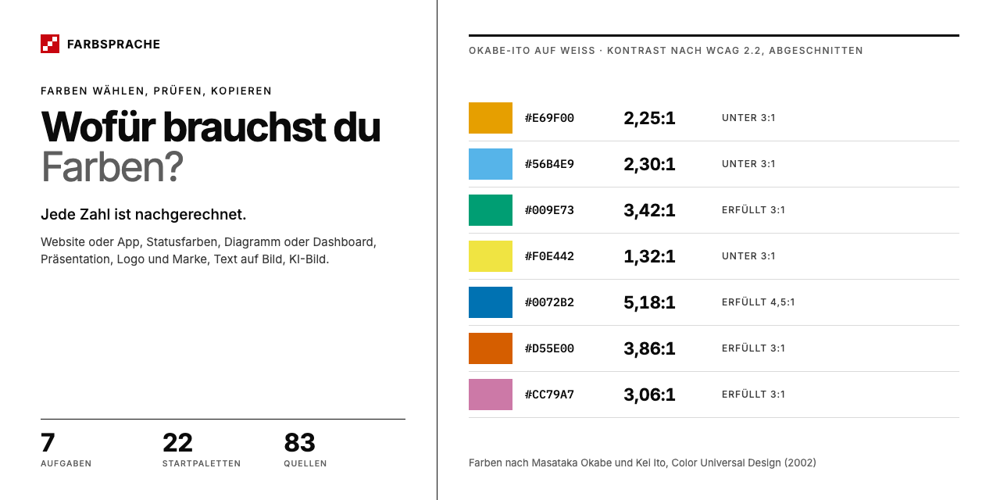

[Read in English → README.md](README.md)

# Farbsprache

**Farben wählen, prüfen, kopieren.** Jede Zahl ist nachgerechnet.

Farbsprache hilft bei der Farbwahl. Du wählst deine Aufgabe, etwa eine Website, ein Diagramm oder eine Präsentation, und bekommst sofort eine fertige Palette mit benannten Rollen, geprüftem Kontrast und Code zum Kopieren. Setzt du deine eigene Farbe ein, rechnet die Seite alles neu und sagt, was sie geändert hat und warum.

**[Website öffnen](https://grundhofer.github.io/farbsprache/)** ·
[Deutsch](https://grundhofer.github.io/farbsprache/de/) ·
[English](https://grundhofer.github.io/farbsprache/en/)



## Worum es geht

Viele Farbwerkzeuge zeigen Paletten. Farbsprache fängt bei der Aufgabe an: 7 Aufgaben mit 22 Startpaletten und 287 geprüften Farbpaaren. Jede Kontrastzahl entsteht beim Bau der Seite oder in deinem Browser, nie von Hand. Maßstab ist WCAG 2.2. 44 Regeln tragen eine Belegstufe (Norm, Forschung, Konvention, Unbelegt). Regeln, Erklärt-Einträge, Methode und Menüwege stützen sich zusammen auf 83 Quellen.

## Inhalt

- **[Aufgaben](https://grundhofer.github.io/farbsprache/de/):** Website oder App, Statusfarben, Diagramm oder Dashboard, Präsentation, Logo und Marke, Text auf Bild, KI-Bild. Jede Aufgabe hat eine fertige Rollenpalette, ein festes Referenzmuster, eine Simulation von Farbsehschwäche und Exporte zum Kopieren.
- **[Palette prüfen](https://grundhofer.github.io/farbsprache/de/pruefen/):** eigene Farben einfügen, Kontraste und Abstände sehen, Korrekturen übernehmen.
- **[Methode](https://grundhofer.github.io/farbsprache/de/methode/):** welche Formeln die Seite nutzt, wie sie rundet, was sie prüft und was nicht.

## Lokal bauen

Benötigt Python 3.12+ und für die Skripttests Node 22. Keine Paketinstallation nötig.

```sh
python3 build.py --fixtures
python3 tools/parity.py
FARBSPRACHE_REQUIRE_BUILD=1 python3 -m unittest discover -s tests -v
FARBSPRACHE_REQUIRE_BUILD=1 node --test tests/*.test.cjs
FARBSPRACHE_REQUIRE_BUILD=1 FARBSPRACHE_JS_DIR=docs/assets node --test tests/*.test.cjs
python3 -m http.server 8000 --directory docs
```

## Projektaufbau

| Pfad | Inhalt |
| --- | --- |
| `build.py` | Statischer Generator: Prüfung, Startpaletten, Seiten, Sprachweiche, README |
| `pages/` | Startseite, Rahmen der Aufgabenseiten, Prüfen, Kurz erklärt, Methode, Quellen, Impressum |
| `tools/color.py`, `web/color.js` | Farbkern in Python und JavaScript mit denselben Testvektoren |
| `tools/export.py`, `web/export.js` | Exporte: CSS, Tailwind v4, Design-Tokens, Hex-Liste, Prompt, Begründung |
| `tools/gen/`, `web/gen/` | Generatoren je Aufgabe |
| `tools/checks.py` | Datenprüfungen vor dem Build |
| `data/` | Aufgaben, Regeln, Erklärt-Einträge, Quellen, Datensätze, Konstanten, Testvektoren, Angaben des Impressums |
| `patterns/` | Referenzmuster und Mini-Vorschauen |
| `web/` | Seitenstil, Seitenskript, Theme, Texte |
| `tests/` | Python- und Node-Tests, Golden-Dateien, Testaufgabe |
| `docs/` | Erzeugte Website; nicht eingecheckt |

GitHub Actions prüft alles und veröffentlicht `main` auf GitHub Pages. Wie man mitarbeitet, steht in [CONTRIBUTING.md](CONTRIBUTING.md).

## Lizenz

Code, auch `patterns/` und `.github/`: [MIT](LICENSE). Texte: [CC BY 4.0](LICENSE-CONTENT.md). Eigene Daten, Startwerte, berechnete Werte und Exporte: [CC0](LICENSE-CONTENT.md). Ausgenommen sind Farben aus Datensätzen wie Okabe-Ito, Paul Tol, ColorBrewer und viridis: Sie behalten ihre eigenen Bedingungen, die Vermerke stehen in den Exporten und auf der Quellenseite. Die Angaben des Impressums in `data/legal.json` stehen unter keiner dieser Lizenzen. Schriften in `web/fonts/` (Inter, IBM Plex Mono): SIL Open Font License 1.1. Das Material aus CSS Color 4 im Farbkern behält die W3C Software and Document License. Die Lizenztexte liegen in `data/licenses/`. Welche Lizenz für welchen Ordner gilt, steht in [LICENSE-CONTENT.md](LICENSE-CONTENT.md).

Schwesterprojekte: [Bildsprache](https://github.com/grundhofer/bildsprache), Bildstile für KI-Bilder, und [Designsprache](https://github.com/grundhofer/designsprache), ein Katalog von UI-Designsprachen.

© Sebastian Grundhöfer
